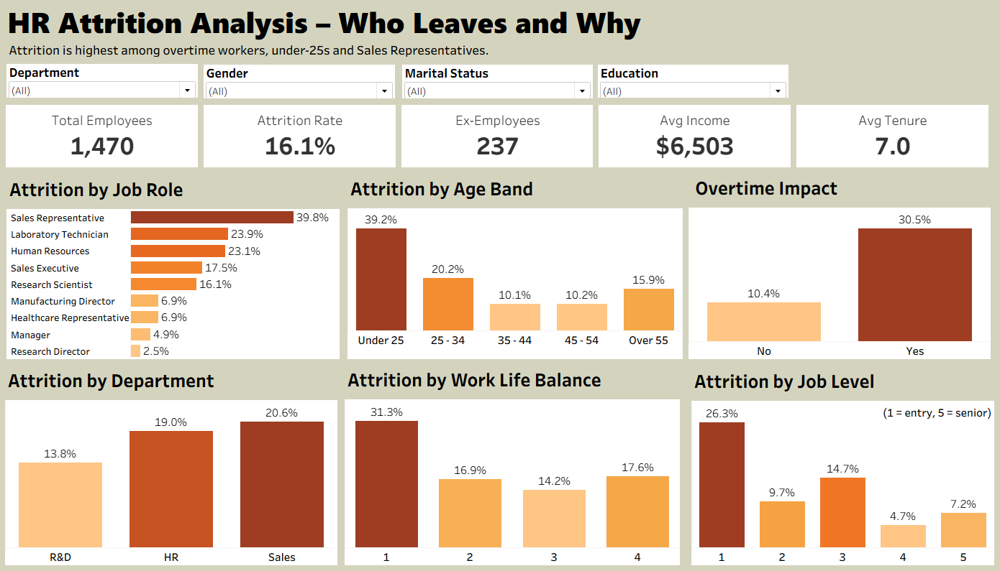

# HR Attrition Analysis Dashboard

An interactive Tableau dashboard that shows who leaves a company and why, built from an HR dataset of 1,470 employees.



**Live dashboard:** [View on Tableau Public](PASTE_YOUR_TABLEAU_PUBLIC_LINK_HERE)

## Key Metrics

| Metric | Value |
|---|---|
| Total Employees | 1,470 |
| Attrition Rate | 16.1% |
| Ex-Employees | 237 |
| Avg Monthly Income | $6,503 |
| Avg Tenure | 7.0 years |

## Dashboard Features

- **Filters:** Department, Gender, Marital Status, Education
- **Attrition by Job Role:** Sales Representative leads at 39.8%, followed by Laboratory Technician (23.9%) and Human Resources (23.1%)
- **Attrition by Age Band:** Under 25 stands out at 39.2%
- **Overtime Impact:** overtime workers leave at 30.5% vs 10.4% for others
- **Attrition by Department:** Sales 20.6%, HR 19.0%, R&D 13.8%
- **Attrition by Work Life Balance:** rating 1 is highest at 31.3%
- **Attrition by Job Level:** entry level (1) leaves at 26.3%, level 4 at 4.7%

## Dataset

`HR_Data_mine.xlsx` has 1,470 rows and 39 columns, including:

| Column | Description |
|---|---|
| Attrition | Whether the employee left (Yes/No) |
| Department, Job Role | Where the employee works |
| Age, CF_age band | Age and grouped age band |
| Over Time | Whether the employee works overtime |
| Monthly Income | Monthly pay |
| Years At Company | Tenure |
| Job Level | Seniority, 1 (entry) to 5 (senior) |
| Work Life Balance, Job Satisfaction | Ratings from 1 to 4 |

No columns or rows were added or removed. `Attrition Rate` is a Tableau calculated field: employees with Attrition = "Yes" divided by total employees.

## Insights

- Overtime workers are about 3x more likely to leave (30.5% vs 10.4%).
- Under-25s and Sales Representatives have the highest attrition, close to 40%.
- Entry-level employees leave far more than senior staff (26.3% vs 4.7% at level 4).
- Poor work-life balance (rating 1) means about double the company average attrition. Ratings 2 to 4 are similar (14% to 18%), and rating 4 comes from a small group of 153 employees, so I avoid reading much into it.

## Tools Used

- Tableau Public (dashboard and calculated field)
- Excel dataset

## Repository Contents

```
├── README.md
├── dashboard.png
├── HR_Data_mine.xlsx
└── HR_Attrition_Dashboard.twbx
```

## How to Use

1. Download this repository.
2. Open the `.twbx` file in Tableau Public or Tableau Desktop.
3. If asked, point the data source to `HR_Data_mine.xlsx`.
